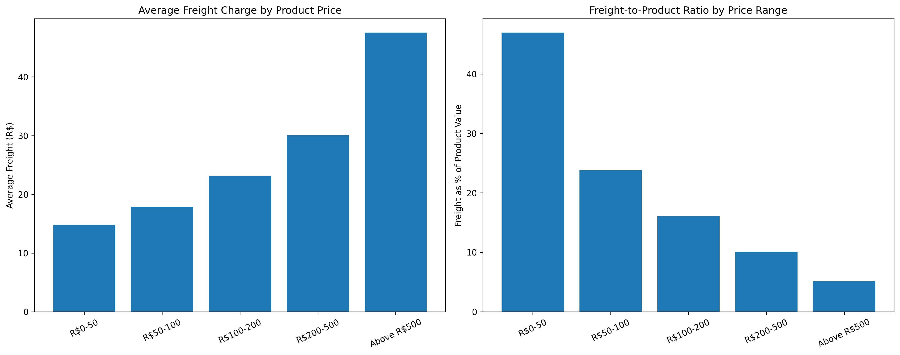
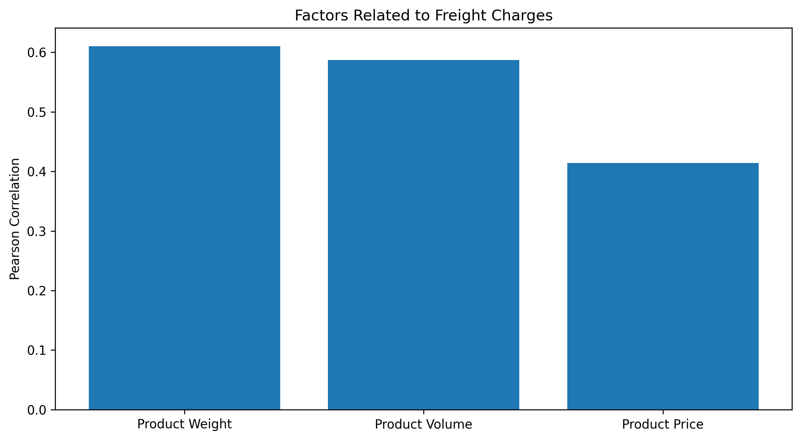
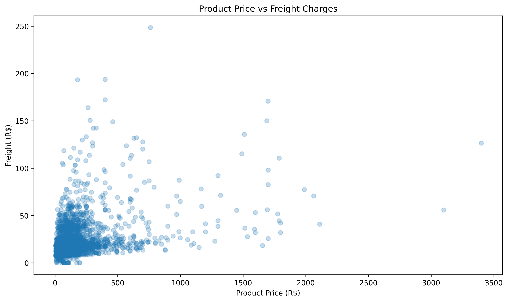
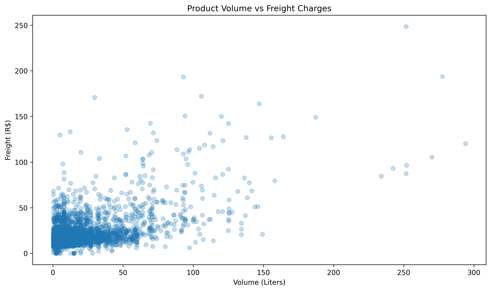

# Supply Chain Analytics Using Python

### Analyzing delivery performance, shipping delays, and freight costs using e-commerce data

## About This Project

For this project, I wanted to understand how different parts of the supply chain affect delivery performance and shipping costs. I worked with the Brazilian E-Commerce Public Dataset by Olist and used Python to explore order processing, carrier handoffs, delivery delays, seller performance, and freight charges.

My goal was to go beyond looking at individual numbers and understand how these factors are connected. I also wanted to identify patterns that could help businesses improve their shipping operations and make better decisions.

## Tools I Used

- **Python:** Data cleaning, analysis, and calculations
- **Pandas and NumPy:** Data preparation and KPI calculations
- **Matplotlib:** Data visualization
- **Google Colab:** Running and documenting the analysis
- **GitHub:** Sharing my project

## Understanding the Dataset

I worked with Olist's orders, order items, products, and product category translation datasets.

The analysis included:

- 99,441 orders
- 112,650 order items
- 32,951 product records
- Delivery dates, order statuses, seller information, product prices, freight charges, and product dimensions

I checked missing values, duplicate records, and data types before starting the analysis. I also converted date columns into the correct format and excluded records with missing or invalid dates where necessary.

## What I Found

### 1. Delivery Performance

I started by comparing actual customer delivery dates with the estimated delivery dates recorded in the dataset.

For the 96,470 delivered orders with valid delivery dates:

- **Average delivery time:** 12.56 days
- **On-time delivery rate:** 93.23%
- **Late delivery rate:** 6.77%
- **Average delay among late orders:** 10.62 days

These results helped me understand overall delivery performance and identify opportunities to investigate delayed shipments.

I also looked at monthly delivery trends to see how performance changed as order volumes increased.

### 2. Order Processing and Carrier Transit Time

Next, I separated delivery time into two stages:

- **Processing and handoff time:** From order purchase to carrier handoff
- **Carrier transit time:** From carrier handoff to customer delivery

I compared these stages across different months to understand where more time was being spent.

This analysis showed that carrier transit generally accounted for a larger portion of delivery time than processing and handoff.

### 3. Seller and Carrier Handoff Performance

I also examined whether sellers handed orders to carriers before their shipping deadlines.

Across eligible order items, the late carrier handoff rate was **5.98%**.

To compare seller performance more fairly, I focused on sellers with at least 30 order items rather than ranking sellers with very small order volumes.

I then compared customer delivery performance for orders with on-time and late carrier handoffs.

- **On-time carrier handoff:** 5.58% late customer deliveries
- **Late carrier handoff:** 26.21% late customer deliveries

This was one of the most interesting findings because orders with late carrier handoffs had a much higher rate of late customer delivery.

### 4. Freight Cost Analysis

I explored how much businesses were spending on freight compared with the value of the products being sold.

The analysis showed:

- **Total product value:** R$13,591,643.70
- **Total freight charges:** R$2,251,909.54
- **Average freight charge per item:** R$19.99
- **Overall freight-to-product ratio:** 16.57%

I also compared freight costs across product categories and price ranges.

One important pattern was that lower-priced products generally had higher freight costs relative to their selling prices.

### 5. Product Categories and Freight Costs

I compared freight-to-product ratios across different product categories.

Some categories, including Christmas supplies, signaling and security products, and food and drink products, had relatively high freight-to-product ratios.

This analysis helped identify categories where shipping expenses represented a larger share of product value.

### 6. What Affects Freight Charges?

I wanted to understand whether product weight, size, or price had the strongest relationship with freight charges.

I calculated Pearson correlations for three factors:

| Factor | Correlation with Freight Charges |
|---|---:|
| Product Weight | 0.610 |
| Product Volume | 0.587 |
| Product Price | 0.414 |

Product weight had the strongest correlation with freight charges, followed closely by product volume. Product price had a weaker relationship.

This suggests that physical product characteristics may be more useful than price alone when exploring freight costs.

### 7. Product Price and Freight Charges

I also created a scatter plot to understand how freight charges changed with product prices.

The correlation was **0.414**, indicating a moderate positive relationship.

### 8. Product Volume and Freight Charges

I calculated product volume using the available length, height, and width measurements.

The correlation between product volume and freight charges was **0.587**.

## Key Takeaways

Through this project, I found that:

- Most delivered orders arrived on or before their recorded estimated delivery dates.
- Late carrier handoffs were associated with a higher chance of late customer delivery.
- Product weight and volume were more strongly related to freight charges than product price.
- Lower-priced products often had higher freight costs relative to product value.
- Comparing delivery and freight KPIs across different groups can help identify areas for further operational investigation.

## What I Learned

This project helped me strengthen my skills in working with multiple related datasets, cleaning operational data, calculating business KPIs, and communicating findings through visualizations.

I also learned how important it is to define metrics carefully. For example, an on-time delivery rate depends on the estimated delivery date recorded in the dataset, while seller handoff performance depends on the shipping deadline.

Understanding these differences helped me interpret the results more accurately.

## Project Files

- [Python Analysis Notebook](Supply_Chain_Analytics.ipynb)
- [Supply Chain KPI Summary](supply_chain_kpi_summary.csv)
- [Freight by Product Price](freight_by_price_group.png)
- [Freight Factor Comparison](freight_factor_comparison.png)
- [Price vs Freight](price_vs_freight.png)
- [Volume vs Freight](volume_vs_freight.png)

## Skills Demonstrated

Python | Pandas | NumPy | Data Cleaning | Exploratory Data Analysis | Supply Chain Analytics | KPI Reporting | Freight Cost Analysis | Data Visualization | Operational Performance Analysis

## A Note About the Results

This is an exploratory portfolio project using historical e-commerce data. The findings describe patterns and associations in the dataset, not proven causes. Some calculations exclude records with missing or invalid values, and seller handoff metrics are measured at the order-item level.

## Final Thoughts

I enjoyed working on this project because it connected technical analysis with real operational questions. It gave me a better understanding of how delivery performance, seller activities, and shipping costs can be analyzed together to support business decisions.

**Author:** Sneha Reddy Konatham
